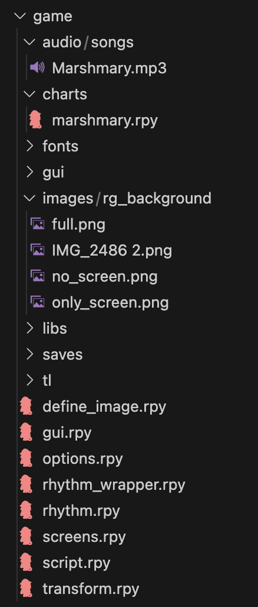
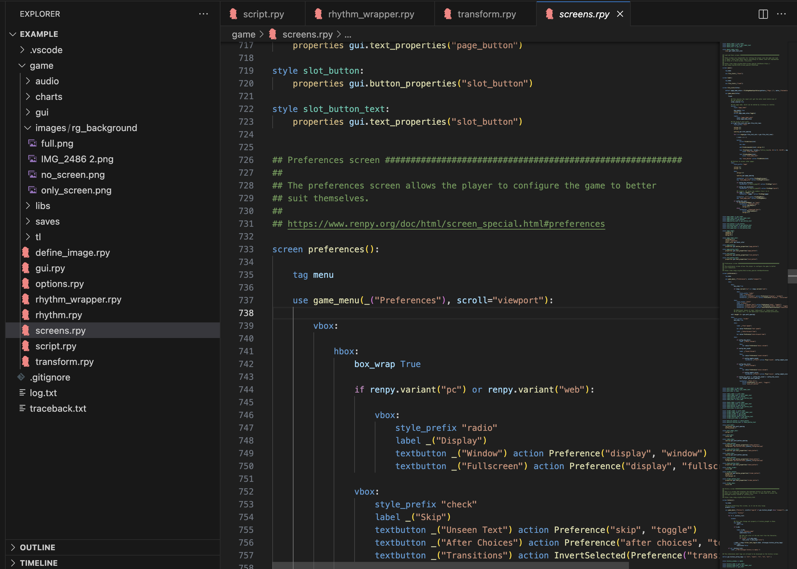
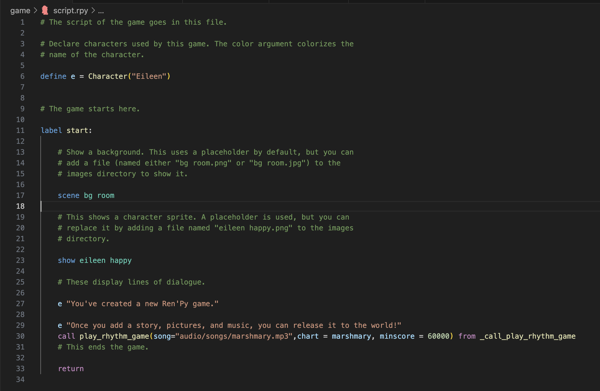
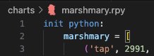

# GETTING STARTED
How to use/incorporate:
1. Make a renpy project
2. Paste the files in this repo into the game folder. You can paste the songs folder into the audio folder and rg_background folder into the images folder  
Example folder:

4. Paste screens_preferences_dropin.rpy's content into your screen.rpy's preferences screen

4. you can refer to your chart with smth like this now!
``
call play_rhythm_game(song="audio/songs/marshmary.mp3",chart = marshmary, minscore = 60000) from _call_play_rhythm_game
``

# HOW TO MAKE CHARTS
1. Create a 4K mania chart on osu!
2. Get the exported osz file and drag it into a folder
3. Go to unzip.py and replace the inputs with your file
4. Get the .osu file you want from the unzipped folder and run that through test.py(change the directory in script)
5. Paste the text output into a .rpy file inside an array like this

6. Make sure to import the song too!
7. You can call it the same way
``
call play_rhythm_game(song="audio/songs/INSERTHERE.mp3",chart = NAMEOFLIST, minscore = 60000) from _call_play_rhythm_game
``